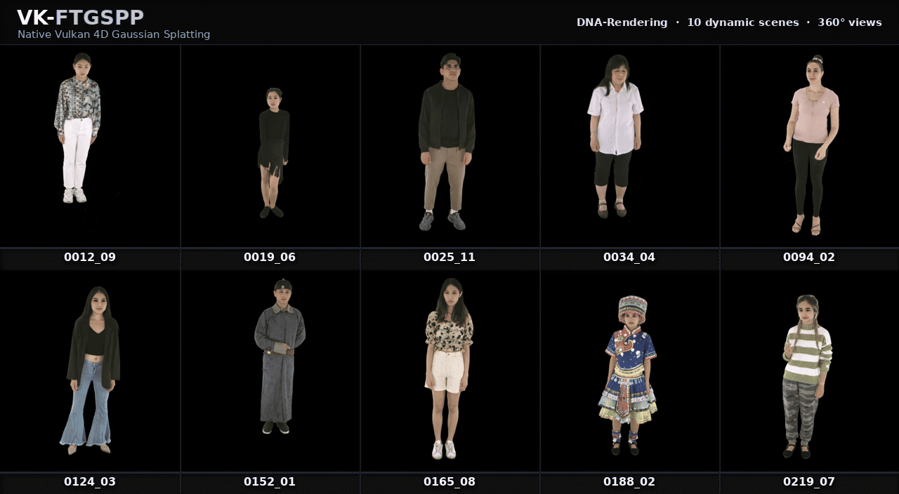

# VK-FTGSPP（FastGS）



**VK-FTGSPP accelerates explicit-velocity 4D Gaussian training with a native
Vulkan pipeline.** On six SelfCap clips measured on an RTX 4090, the reported
train-only timings show a **2.22× aggregate speedup** over the original
CUDA + gsplat implementation, with individual-scene throughput ratios up to
**3.14×**. Evaluation and hard separation are excluded; relocation is timed
differently by the two implementations. See the
[timing definitions and results](docs/performance.md).

The Linux/NVIDIA runtime uses Python 3.12 and keeps ordinary training Torch-free.
Clone the repository, run one setup script, then use the `ftgspp` CLI. YAML
examples live in the clone; the wheel provides the command rather than a public
import library.

**Training uses one GPU.** By default, one view produces one optimizer update.
Foreground runs can opt into `train.batch_size: 4`: four sequential views share
one FP32 mean gradient and one Adam update. See [training configuration](docs/usage.md).
Two-device synchronous training is **in development**: the pair code,
`dev/tests/gpu/` scripts, and the controlled GPU workflow stay in the tree for
engineering, but they are not a supported user path.

**License:** non-commercial research and educational use only, not an
OSI-approved or commercially permissive open-source license. Read [LICENSE](LICENSE)
and [third-party notices](THIRD_PARTY.md) before use or redistribution.

## Requirements

- Linux x86_64 with glibc 2.28+ and a supported NVIDIA Vulkan GPU; this does
  not include every NVIDIA model
- **Python 3.12.x** (3.11 and 3.13 will fail the native build)
- `build-essential` with a C++17 compiler, `git`, `curl`, CA certificates,
  `libvulkan-dev`, and FFmpeg
  with `ffprobe` and `libx264` (installed or checked by `scripts/setup.sh`)
- Slang **2026.10** with `slangc` on `PATH` (the setup script pins this)
- [uv](https://docs.astral.sh/uv/) **0.11.29**

The compatibility decision is capability-based. A supported device must be a
physical NVIDIA GPU that `ftgspp doctor` reports as **`VIABLE`**;
`POSSIBLY VIABLE` is not sufficient for the supported training path. Native
training requires the compiled subgroup, workgroup, shared-memory, push-constant,
Int16/Int64, and float32 buffer atomic-add limits. See the complete
[hardware compatibility, runnable-model estimate, and validation matrix](docs/hardware.md).

## Installation

```bash
git clone https://github.com/sevendogs81-cyber/VK-FTGSPP.git
cd VK-FTGSPP
bash scripts/setup.sh
source .venv/bin/activate
```

The default is the lightweight, Torch-free Vulkan training runtime for users
with prepared masks and PLYs. Starting from raw RGB instead uses:

```bash
bash scripts/setup.sh --with-init
```

That adds BiRefNet-HR and DA3. `--with-birefnet` and `--with-da3` install only
one preparation capability. `--with-lpips` adds the optional locked final-test
metric without enabling it during training. Full component requirements are in
[docs/install.md](docs/install.md).

## First training run

Work from the clone. Index an existing rectangular multi-view grid (pixels
stay in place):

```text
data/my_capture/images/<camera_id>/<numeric-frame>.(png|jpg|...)
```

```bash
ftgspp prepare dataset --images data/my_capture/images --fps 30 --eval-cameras 3
```

`prepare` writes a starter YAML and prints initialization instructions. Replace
`3` with a hold-out camera that already exists under `images/`, or omit
`--eval-cameras`. Training uses the Vulkan device ID reported by
`ftgspp doctor`, which may differ from the `nvidia-smi` index.

With camera calibration, scene-mode `init.backend: auto` uses a complete
keyframe RGB PLY set under `data/my_capture/points_stride10/`, or generates
points with DA3. Uncalibrated captures require DA3 to estimate cameras as well.
Install DA3 with `--with-da3` or `--with-init` and make its weights available
locally or through the network when needed. See [usage](docs/usage.md) for data
requirements, resume, evaluation, export and foreground reconstruction.

Once calibration and PLYs are ready, or DA3 is available:

```bash
ftgspp train --config data/my_capture/ftgspp.yaml --devices 0
```

## View and render results

Headless PNG and optional FFmpeg video export work with the default install:

```bash
ftgspp render --run /path/to/run --camera 0 --time 1.25 \
  --device 0 --output frames/still
```

For a local GLFW / Dear ImGui window, build the desktop option and open a run:

```bash
bash scripts/setup.sh --with-viewer
ftgspp viewer --run /path/to/run --device 0
```

On an SSH GPU server without a display session, install the browser server and
forward its loopback port:

```bash
bash scripts/setup.sh --with-remote
ftgspp viewer --remote --run /path/to/run --device 0
```

Run the tunnel command on your local computer:

```bash
ssh -L 8765:127.0.0.1:8765 USER@SERVER
```

Open the exact tokenized URL printed by the server. Both viewers use the native
Vulkan 4DGS renderer and support capture/free cameras, playback, screenshots,
camera paths and export. See [viewer setup, controls and limits](docs/viewer.md).

## Next

- [Hardware compatibility, estimated runnable models, and validated GPUs](docs/hardware.md)
- [Foreground, DA3, SelfCap, research YAML](docs/usage.md)
- [Local, SSH browser and headless viewers](docs/viewer.md)
- [SelfCap timing and B1/B4 throughput](docs/performance.md)
- [Architecture](docs/architecture.md)
- [Migration from older FTGSPP layouts](docs/migration.md)
- [Maintainer notes](CONTRIBUTING.md)

## Repository layout

```text
VK-FTGSPP/
├── src/ftgspp/         # installed Python CLI and orchestration
├── native/            # Vulkan C++ runtime and Slang shaders
├── examples/          # public YAML and manifest templates
├── scripts/           # supported one-command installer
├── docs/              # hardware, install, usage, viewer and architecture
├── dev/               # tests and unsupported research tools
├── .github/workflows/  # CPU, artifact and controlled GPU checks
├── pyproject.toml      # package, dependency and build definition
└── uv.lock             # reproducible Python dependency lock
```

## Development

```bash
uv sync --locked --python 3.12 --extra dev --no-install-project
uv run --no-sync pytest
```

Use this only when changing code. It rewrites `.venv` from the lockfile and
does **not** install the wheel; CPU tests skip `_ftgspp_vk` when it is
missing. Use the environment created by `scripts/setup.sh` to run `ftgspp`.
Shader or C++ changes need `slangc` on `PATH`. Rebuild and install with
`uv pip install --python .venv/bin/python --reinstall --no-deps .`;
`uv build --python 3.12` only creates an artifact and does not install it.
CPU contract tests and native GPU numerical tests are engineering-correctness
gates, not evidence of reconstruction quality.
